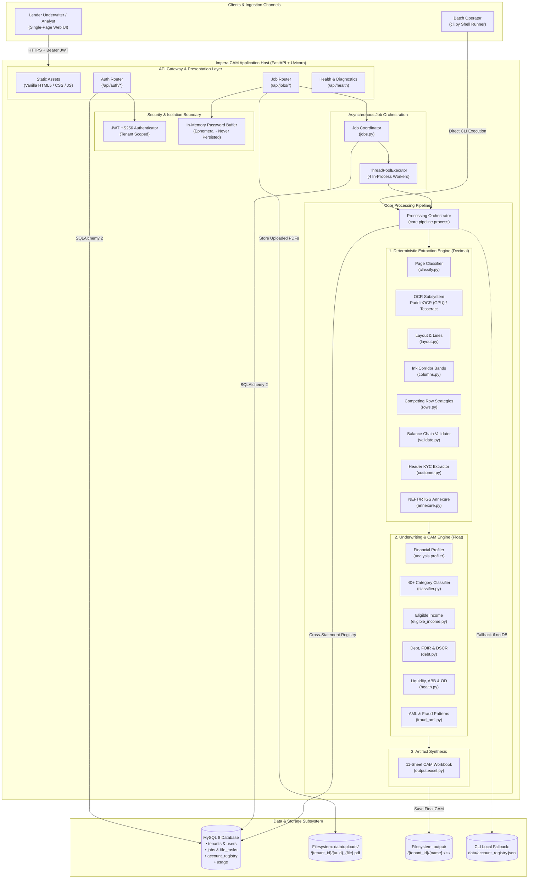
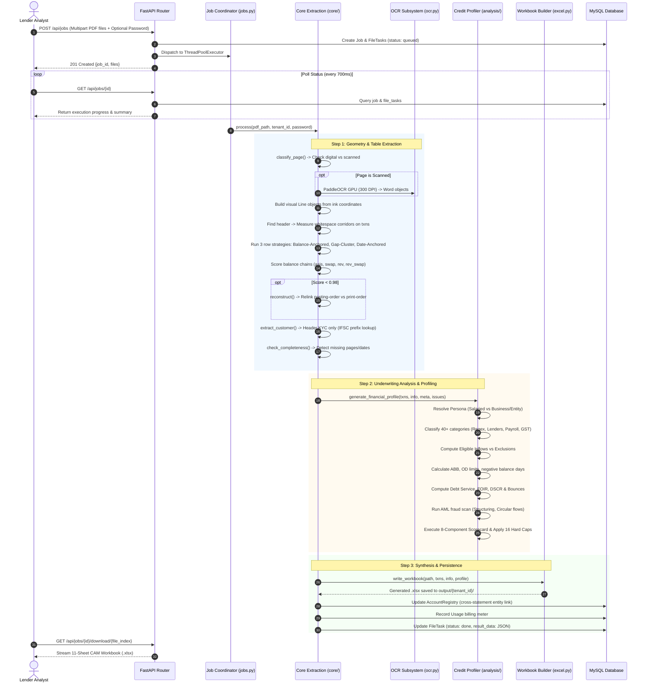
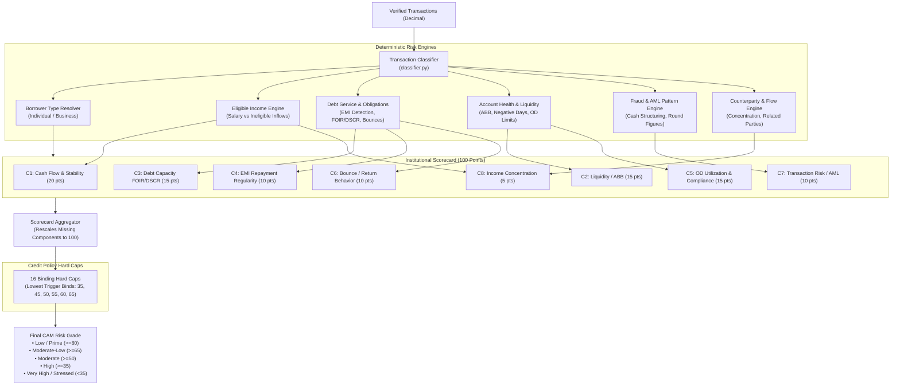
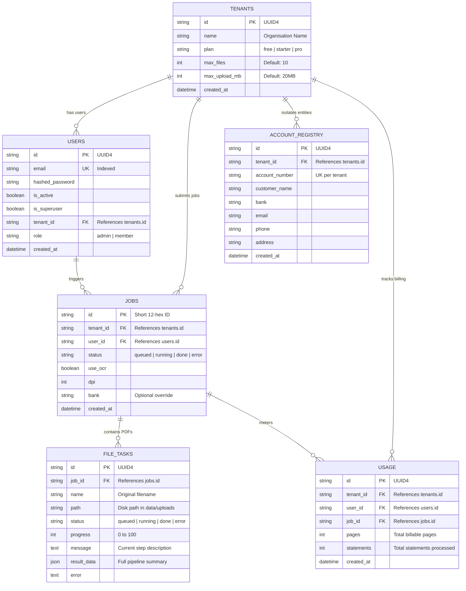

# System Architecture & Design Canvas — Impera CAM

> **System**: Impera CAM (Bank Statement Extractor & Credit Appraisal Memorandum Engine)  
> **Version**: 2.0.0 (Multi-Tenant SaaS Edition)  
> **Architecture Status**: Active Record (`agentic/architecture.md` authoritative)  
> **Primary Audience**: Engineering, Product Owners, Credit Policy Architects, Underwriters

---

## 1. System Vision & Value Proposition

**Impera CAM** is a template-free extraction and automated credit underwriting platform tailored specifically for Indian banking data. It ingests complex, non-standard Indian bank statement PDFs (digital or scanned, across retail, MSME, and corporate accounts) and synthesizes them into an underwriting-grade **11-sheet Credit Appraisal Memo (CAM) Excel workbook** alongside an auditable **100-point credit risk profile**.

### The Core Architectural Axiom: Mathematical Ground Truth
Extracting PDF tables without templates is notoriously brittle across hundreds of Indian banks. Impera CAM eliminates guessing by utilizing the **printed running balance** as an infallible mathematical oracle:
$$\text{Previous Balance} - \text{Debit} + \text{Credit} \equiv \text{Balance} \quad (\pm ₹0.02)$$

Instead of relying on LLM hallucination or fragile OCR templates, the extraction engine runs competing layout hypotheses and lets the **balance chain equation** score and select the ground-truth strategy.

```
┌────────────────────────────────────────────────────────────────────────────────────────┐
│                                   CORE VALUE DRIVERS                                   │
├─────────────────────────┬───────────────────────────────┬──────────────────────────────┤
│  Template-Agnostic      │  Proof of Correctness         │  Deterministic CAM Scoring   │
│  Extracts tables from   │  Every row is audited against │  8-component, 100-pt scorecard│
│  any Indian bank using  │  running balances; breaks     │  with 16 hard credit caps    │
│  ink geometry, not      │  are highlighted (CHECK)      │  and deep borrower persona   │
│  rigid templates.       │  rather than quietly hidden.  │  resolution.                 │
└─────────────────────────┴───────────────────────────────┴──────────────────────────────┘
```

---

## 2. High-Level System Architecture (C4 Context & Container)

The platform operates as a self-contained multi-tenant system with **zero outbound API dependencies** (no external AI APIs, credit bureaus, or bank aggregator endpoints). All OCR and scoring algorithms execute in-process.



---

## 3. End-to-End Processing Pipeline

The execution journey transforms raw unclassified PDF bytes into an audited financial memo through two deterministic engines.



---

## 4. Deep-Dive: Extraction Engine Architecture (`app/core/`)

The extraction engine is governed by strict deterministic rules ensuring ₹0.02 numerical precision:

### 1. Invariant Coordinate Geometry
- **Schema Unification**: Scanned pages detour through [ocr.py](file:///d:/Company%20Projects/Impera%20CAM/app/core/ocr.py) and emit the identical `Word(text, x0, x1, top, bottom, page)` dataclass as [layout.py](file:///d:/Company%20Projects/Impera%20CAM/app/core/layout.py). Downstream extractors are completely agnostic of scan status (`[H7]`).
- **Ink-Based Column Boundaries**: Traditional tools measure column boundaries from header text boxes. However, Indian banks often misalign headers (e.g., Bandhan Bank places `DEBITS` 40pt to the left of numbers). Impera CAM identifies column bands by slicing vertical whitespace corridors across **transaction rows only**, filtering out noisy header/footer geometry (`[columns.py](file:///d:/Company%20Projects/Impera%20CAM/app/core/columns.py)`).

### 2. Tri-Strategy Row Assembly
Bank tables suffer from wrapped narrations, multi-line dates, and staggered cells. [rows.py](file:///d:/Company%20Projects/Impera%20CAM/app/core/rows.py) runs three parallel algorithms:
1. **Balance-Anchored**: Since every transaction prints exactly one running balance, balance-bearing lines serve as primary anchors. Wrapped fragments are attached by splitting vertical gaps.
2. **Gap-Clustered**: Groups visual lines using adaptive line-spacing thresholds.
3. **Date-Anchored**: Uses transaction dates as row boundaries for statements with merged balance lines.

### 3. Balance Chain Scoring & Relinking
[validate.py](file:///d:/Company%20Projects/Impera%20CAM/app/core/validate.py) tests all assembled candidates across 4 permutation modes:
- `asis`: Normal chronological posting order.
- `swap`: Swapped Debit and Credit columns (common in reverse statement exports).
- `rev`: Reverse chronological order (newest transaction first).
- `rev_swap`: Reverse chronological with swapped debit/credit.

> [!IMPORTANT]
> **Out-of-Order Relinking**: When a statement sorts transactions by *transaction date* but maintains running balances in *posting order*, chronological evaluation breaks. If score $< 0.98$, `reconstruct()` solves the directed graph:
> $$\text{Required Predecessor} = \text{Current Balance} + \text{Debit} - \text{Credit}$$
> This reconstructs the authentic ledger sequence without guessing.

---

## 5. Deep-Dive: Underwriting & CAM Engine (`app/analysis/`)

The CAM engine converts transaction ledgers into an institutional credit memorandum via 17 deterministic modules:



### The 8 Scorecard Dimensions & Policy Weightings

| Dimension | Weight | Primary Indicators & Evaluation Logic |
|---|:---:|---|
| **C1. Cash-Flow Stability & Margin** | **20%** | Inflow consistency, monthly net burn, operating cash-flow margin. |
| **C2. Liquidity / ABB** | **15%** | Average Bank Balance (ABB), 10-day buffer ratios, credit turnover vs limit. |
| **C3. Debt Capacity (FOIR / DSCR)** | **15%** | Fixed Obligation to Income Ratio (Retail) or Debt Service Coverage Ratio (Commercial). |
| **C4. EMI Regularity** | **10%** | Scheduled loan debit recurrence, timely repayments without bounces. |
| **C5. Overdraft / Facility Compliance** | **15%** | Utilization rate ($\le 90\%$), negative days count, limit adherence. |
| **C6. Bounce & Return Behavior** | **10%** | Inward and outward return counts, cheque/NACH dishonour frequency. |
| **C7. Transaction Risk & AML** | **10%** | High-value cash velocity, round-figure structuring, circular party flows. |
| **C8. Income Stability & Concentration**| **5%** | Revenue dependency on top counterparties ($\le 35\%$), counterparty diversity. |

### The 16 Binding Hard Caps
Regardless of high composite scores, negative signals enforce unconditional scoring ceilings:
- **Cap 35**: $>5$ negative-balance days on a non-OD account.
- **Cap 45**: Missing holder identity; no verifiable income; $\ge 2$ EMI bounces; $\ge 2$ outward bounces.
- **Cap 50**: FOIR or DSCR falling into severe non-serviceable bands.
- **Cap 55**: Cash deficit $>25\%$ of inflows; OD utilization $>92\%$.
- **Cap 60**: Single outward bounce; unclassified inflows $>15\%$; cash deposits $\ge 50\%$.

---

## 6. Deliverable Surface Architecture: The 11-Sheet CAM Workbook

The ultimate output delivered to credit committees is an openpyxl-generated `.xlsx` workbook configured with styling, frozen header panes, conditional color coding, and formulaic reconciliations.

```
┌────────────────────────────────────────────────────────────────────────────────────────┐
│                        CAM WORKBOOK SHEET STRUCTURE (openpyxl)                         │
├────┬─────────────────────────────┬────────────────────────────────────────────────────┤
│ #  │ Sheet Name                  │ Purpose & Contents                                 │
├────┼─────────────────────────────┼────────────────────────────────────────────────────┤
│ 1  │ Financial_Profile           │ Executive CAM summary: 100-pt scorecard, rating    │
│    │                             │ grade, hard cap triggers, strengths, and risks.   │
├────┼─────────────────────────────┼────────────────────────────────────────────────────┤
│ 2  │ Income_Analysis             │ Verified eligible income vs excluded credits       │
│    │                             │ (transfers, reversals, loans, high-risk cash).    │
├────┼─────────────────────────────┼────────────────────────────────────────────────────┤
│ 3  │ Monthly_Analysis            │ Month-on-month revenue, expense, net cashflow,    │
│    │                             │ ABB, and liquidity metrics across statement span.  │
├────┼─────────────────────────────┼────────────────────────────────────────────────────┤
│ 4  │ Transactions                │ Full reconstructed ledger with classification,    │
│    │                             │ counterparty IDs, purpose flags, and CHECK tags.  │
├────┼─────────────────────────────┼────────────────────────────────────────────────────┤
│ 5  │ Customer_Info               │ KYC data extracted above table: Bank, IFSC, MICR,  │
│    │                             │ Account #, PAN, Address, Period, OD Limit.        │
├────┼─────────────────────────────┼────────────────────────────────────────────────────┤
│ 6  │ Debt_Obligations            │ Identified EMIs, lender names, recurrence,        │
│    │                             │ interest vs principal estimates, FOIR and DSCR.   │
├────┼─────────────────────────────┼────────────────────────────────────────────────────┤
│ 7  │ Counterparties              │ Concentration of top inflow/outflow counterparties,│
│    │                             │ channel breakdown (UPI, NEFT, RTGS, IMPS, Cash).  │
├────┼─────────────────────────────┼────────────────────────────────────────────────────┤
│ 8  │ Risk_Anomaly_Flags          │ AML red flags, potential structuring, circular     │
│    │                             │ transactions, and tax evasion indicators.         │
├────┼─────────────────────────────┼────────────────────────────────────────────────────┤
│ 9  │ Validation                  │ Mathematical audit: strategy chosen, pass rate,   │
│    │                             │ orientation, breakdown of breaking rows & rupee Δ.│
├────┼─────────────────────────────┼────────────────────────────────────────────────────┤
│ 10 │ PDF_Field_Validation        │ Diagnostic presence checklist of detected columns │
│    │                             │ (Date, Narration, Ref, Debit, Credit, Balance).   │
├────┼─────────────────────────────┼────────────────────────────────────────────────────┤
│ 11 │ Calculation_Reconciliation  │ Line-by-line mathematical proofs reconciling      │
│    │                             │ ledger opening/closing balances to CAM metrics.   │
└────┴─────────────────────────────┴────────────────────────────────────────────────────┘
```

---

## 7. Multi-Tenant Data Model & Entity Relations

Persistence is handled by **MySQL 8** (via SQLAlchemy 2 and Alembic migrations) ensuring cryptographic data isolation between competitive financial institutions.



---

## 8. System Design Canvas

The table below encapsulates the holistic technical, operational, and business architecture of Impera CAM:

```
╔══════════════════════════════════════════════════════════════════════════════════════════════════════╗
║                                      IMPERA CAM DESIGN CANVAS                                        ║
╠══════════════════════════════════════════════════════════════════════════════════════════════════════╣
║ 1. PROBLEM & USERS                                                                                   ║
║ • Target Users: Credit Underwriters (NBFCs, Banks, Co-ops), DSAs, Risk Analysts.                     ║
║ • Problem: Hand-keying disparate Indian statement formats is slow, error-prone, and untraceable.     ║
║ • Value: Instant, template-free extraction with mathematical balance-chain proof & scored CAM memo.  ║
╠══════════════════════════════════════════════════════════════════════════════════════════════════════╣
║ 2. INGESTION & DATA BOUNDARIES                                                                       ║
║ • Ingestion: Multipart PDF uploads (up to 25 files / 40MB limit; tenant-capped to 10 files / 20MB).  ║
║ • Passwords: In-memory only; cleared from RAM after execution; never logged or saved to disk [H10]. ║
║ • OCR Detour: PaddleOCR GPU (cu126) for scanned pages; unified Word dataclass schema [H7].          ║
╠══════════════════════════════════════════════════════════════════════════════════════════════════════╣
║ 3. COMPUTATION ENGINE                                                                                ║
║ • Exact Arithmetic: decimal.Decimal used across app/core/ to eliminate floating-point drift [H3].   ║
║ • Geometry Analysis: Vertical whitespace corridors on transaction ink detect column bands.           ║
║ • Competing Strategies: Balance-anchored, Gap-clustered, Date-anchored scored by balance chain.      ║
║ • Disordered Ledger Relinking: Graph reconstruction for statements printed out of posting order.     ║
╠══════════════════════════════════════════════════════════════════════════════════════════════════════╣
║ 4. CREDIT APPRAISAL ENGINE (CAM)                                                                     ║
║ • Rule-First Classifier: 40+ categories, loan/lender dictionaries, regex payroll & tax rules.       ║
║ • 8-Component Scorecard: Cash Flow (20), ABB (15), FOIR/DSCR (15), EMI Regularity (10),              ║
║   OD Utilization (15), Bounces (10), AML Risk (10), Concentration (5).                               ║
║ • 16 Hard Caps: Critical risk triggers (negative days, bounces, cash structuring) override scores.   ║
╠══════════════════════════════════════════════════════════════════════════════════════════════════════╣
║ 5. PERSISTENCE, STORAGE & TENANCY                                                                    ║
║ • Multi-Tenant Isolation: Every DB row, upload path, and output file scoped by tenant_id [H6].      ║
║ • Database: MySQL 8 (InnoDB) via SQLAlchemy 2; schema tracked with Alembic migrations.               ║
║ • Filesystem: Partitioned by tenant (data/uploads/{tenant_id} and output/{tenant_id}).               ║
╠══════════════════════════════════════════════════════════════════════════════════════════════════════╣
║ 6. SECURITY, PRIVACY & COMPLIANCE                                                                    ║
║ • Identity: Stateless Bearer JWT tokens (HS256) with passlib/bcrypt password hashing.                ║
║ • Zero External Exfiltration: Zero LLM / external API calls; all models run local in-process.        ║
║ • DPDP Compliance: Indian Personal Data Protection rules apply; 6h upload retention policy.          ║
╠══════════════════════════════════════════════════════════════════════════════════════════════════════╣
║ 7. OBSERVABILITY & INTERACTION SURFACES                                                              ║
║ • Deliverables: 11-sheet Openpyxl Excel workbook (.xlsx) + REST JSON API.                           ║
║ • UI: Single-page application with cool paper/ledger aesthetic, live polling, and status cards.      ║
║ • CLI: cli.py runner for headless batch folder processing.                                           ║
╚══════════════════════════════════════════════════════════════════════════════════════════════════════╝
```

---

## 9. Engineering Invariants & Guardrails

The system follows strict engineering conventions (`agentic/rules.md`):

1. **[H1] Balance Chain Supremacy**: The balance chain is the sole arbiter of extraction truth. Any code change reducing pass rates or changing winning strategies is a regression.
2. **[H2] Explicit Failure Visibility**: Failing rows are prominently marked `CHECK` in amber/red. Unverified rows must **never** be interpolated or quietly presented as valid.
3. **[H3] Strict Decimal Core**: All financial arithmetic in `app/core/` uses `decimal.Decimal`. Conversion to float occurs strictly at workbook rendering boundaries.
4. **[H4] Credit Policy Immutability**: Scorecard weights, caps, and risk bands cannot be modified without formal approval and logging in `agentic/memory.md`.
5. **[H5] Header-Only KYC Extraction**: Holder names and account details are extracted exclusively above the table (`htop`) to prevent table cell data poisoning.
6. **[H6] Cryptographic Tenant Isolation**: Every query and filesystem access must validate `tenant_id`. Cross-tenant data leakage is strictly prohibited.
7. **[H7] Unified Schema Boundary**: OCR and PDF text extractors emit identical `layout.Word` schemas. Downstream logic never branches on whether a page was scanned.

---

## 10. Technical Debt, Known Edge Cases & Roadmap

Through comprehensive codebase inspection, several known edge cases and structural defects have been identified for resolution during **Phase 4 (Hardening)**:

```
┌────────────────────────────────────────────────────────────────────────────────────────┐
│                        CRITICAL DEFECT & HARDENING MATRIX                             │
├──────────────────────────┬─────────────────────────────────────┬───────────────────────┤
│ Defect / Debt Item       │ Code Location                       │ Architectural Impact  │
├──────────────────────────┼─────────────────────────────────────┼───────────────────────┤
│ 1. Detached Session Bug  │ app/jobs.py:75-98                   │ Potential 500 error on│
│                          │                                     │ lazy-loading tasks    │
│                          │                                     │ after session close.  │
├──────────────────────────┼─────────────────────────────────────┼───────────────────────┤
│ 2. Bounce Double-Count   │ app/analysis/classifier.py:744-749  │ Both debit & return   │
│                          │ app/analysis/returns.py:60-61       │ credit marked OWN;    │
│                          │                                     │ false Cap 45 trigger. │
├──────────────────────────┼─────────────────────────────────────┼───────────────────────┤
│ 3. Cash Structuring Floor│ app/analysis/fraud_aml.py:150-199   │ Low branch unreachable│
│                          │                                     │ structuring always    │
│                          │                                     │ scores >= MEDIUM.     │
├──────────────────────────┼─────────────────────────────────────┼───────────────────────┤
│ 4. Substring Match Risk  │ app/analysis/eligible_income.py:117 │ "RENT" in narration   │
│                          │                                     │ matches CURRENT,      │
│                          │                                     │ PARENT, TORRENT.      │
├──────────────────────────┼─────────────────────────────────────┼───────────────────────┤
│ 5. PII in Workspace Tree │ Bank/, output/, data/registry.json  │ Real statement PDFs & │
│                          │                                     │ workbooks in repo     │
│                          │                                     │ without gitignore.    │
└──────────────────────────┴─────────────────────────────────────┴───────────────────────┘
```

### Roadmap Alignment
- **Phase 1 (Extraction Engine)**: Complete.
- **Phase 2 (CAM Analysis Layer)**: Complete.
- **Phase 3 (Multi-Tenant SaaS Platform)**: Complete.
- **Phase 4 (Hardening & Regression Guardrails)**: **NEXT UP**. Fix detached session, isolate PII, build synthetic automated test suite, fix scoring edge cases.
- **Phase 5 (Security & DPDP Compliance)**: Harden CORS, lock JWT secret, establish automated PII purging and audit trails.
